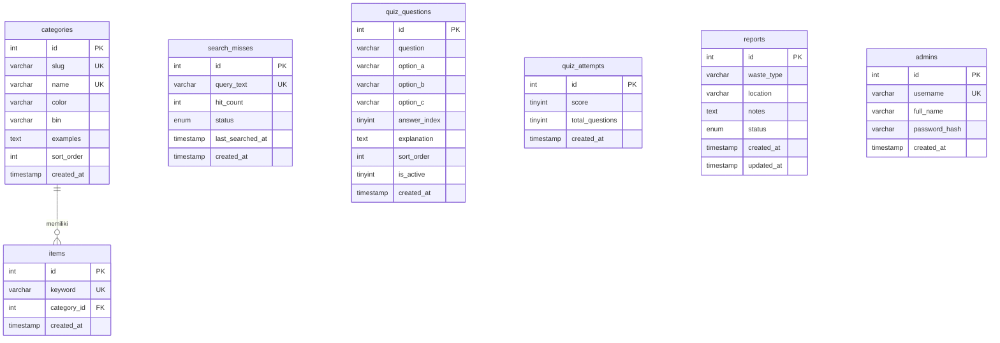

# Product Requirements Document (PRD v1.0) — Pilahin

**Pilahin — Panduan Pilah Sampah Rumah Tangga & Pelaporan Sampah Liar**  
*Arsitektur Full-Stack PHP Native (Tanpa Framework) + MySQL/MariaDB (XAMPP)*

---

## 1. Latar Belakang & Keselarasan SDGs

Pengelolaan sampah rumah tangga di Indonesia masih menghadapi dua kendala utama di tingkat warga: kebingungan menentukan jenis tempat sampah yang sesuai (terutama untuk sampah B3 dan elektronik/*e-waste*) serta lambatnya pencatatan dan tindak lanjut tumpukan sampah liar di lingkungan sekitar.

**Pilahin** menjawab permasalahan tersebut melalui aplikasi web edukatif dan partisipatif yang mendukung agenda **Sustainable Development Goals (SDGs)**:
1. **SDG 12 — Responsible Consumption and Production (Konsumsi dan Produksi yang Bertanggung Jawab):** Mengedukasi warga melalui kamus pencarian cepat 6 jenis tempat sampah dan kuis interaktif dengan rekap skor pemahaman.
2. **SDG 11 — Sustainable Cities and Communities (Kota dan Permukiman yang Berkelanjutan):** Memfasilitasi pelaporan lokasi tumpukan sampah liar dari warga yang dikelola secara terstruktur oleh admin hingga tuntas dan dapat diekspor sebagai laporan CSV ke perangkat lingkungan setempat (RT/RW/DLH).

---

## 2. Tujuan Proyek & Arsitektur Sistem

- **PHP Native murni tanpa framework & tanpa Composer:** Mengikuti standar Praktikum Pemrograman Web I (XAMPP + Apache + MySQL + `mysqli` prosedural dengan *Prepared Statements*).
- **Transisi mulus dari versi statis:** Mempertahankan UI/UX responsif yang sudah ada sekaligus mengganti data statis (`legacy/data.js`) dan `localStorage` dengan database relasional MySQL `pilahin_db`.
- **10 Modul Terintegrasi (memenuhi ketentuan minimal 9 modul Responsi 2):** Setiap modul terhubung langsung dengan kebutuhan logika bisnis dan menerapkan seluruh 7 topik praktikum (HTML, HTML Lanjut, CSS, JavaScript, PHP Dasar, PHP CRUD, dan PHP Session).

---

## 3. Target Pengguna & Model Akses

| Peran | Mekanisme Akses | Ruang Lingkup Fitur |
|---|---|---|
| **Warga / Pengunjung Publik** | Tanpa login (akses langsung di `index.php`) | Cari kategori sampah, jelajahi 6 panduan warna tempat sampah, kerjakan kuis pemilahan (skor dicatat diam-diam ke server untuk metrik edukasi), dan kirim laporan sampah liar. |
| **Admin / Pengelola** | Login via **PHP Session** (`admin/login.php`) | Akses Dashboard Statistik SDGs, Export CSV laporan, kelola status & hapus laporan, CRUD kategori, CRUD kata kunci + tinjau *Search Miss Log*, serta CRUD bank soal kuis. |

---

## 4. Pemetaan 10 Modul Bisnis Terintegrasi

| Kode | Modul Bisnis | Sisi | Logika Bisnis Utama | Materi Praktikum |
|---|---|---|---|---|
| **M1** | **Pencarian Jenis Sampah** | Publik (`index.php`, `api/search.php`) | Pencarian kata kunci dengan prioritas *exact match* &rarr; *substring 2 arah* &rarr; *keyword* terpanjang, plus highlight animasi bin tempat sampah. | HTML, CSS, JS (`fetch`, DOM), PHP Dasar, PHP CRUD (`READ` JOIN) |
| **M2** | **Katalog 6 Kategori Tempat Sampah** | Publik (`index.php`, `api/categories.php`) | Menampilkan 6 ikon bin interaktif, warna hex, label bin, contoh sampah, serta menyinkronkan opsi dropdown form laporan. | HTML Semantik, CSS Responsive, JS DOM, PHP CRUD (`READ`) |
| **M3** | **Kuis Edukasi Pemilahan** | Publik (`index.php`, `api/quiz.php`) | Menyajikan soal aktif dari database beserta umpan balik langsung per pilihan jawaban dan penjelasan edukatif. | HTML, CSS, JS State/Event, PHP Dasar, PHP CRUD (`READ`) |
| **M4** | **Rekap & Analitik Skor Kuis** | Publik & Admin (`api/quiz_attempts.php`, `admin/index.php`) | Mencatat setiap penyelesaian kuis secara otomatis ke tabel `quiz_attempts` di latar belakang untuk KPI SDG 12 di dashboard admin (UI kuis publik tetap identik). | JS `fetch` (`POST`), PHP Dasar, PHP CRUD (`CREATE`, `READ` agregasi) |
| **M5** | **Pelaporan Tumpukan Sampah Liar** | Publik (`index.php`, `api/reports.php`) | Validasi input client + server (whitelist jenis sampah, batas panjang lokasi & keterangan) dan simpan ke MySQL dengan status awal `baru`. | HTML Lanjut (`form`, `select`, `textarea`), JS `fetch`, PHP Dasar, PHP CRUD (`CREATE`) |
| **M6** | **Autentikasi & Proteksi PHP Session** | Admin (`admin/login.php`, `admin/logout.php`, `includes/auth.php`) | Login menggunakan `password_verify()`, `session_regenerate_id(true)`, cookie `HttpOnly` + `SameSite=Lax`, guard `require_admin()`, *flash message*, & CSRF token. | HTML Lanjut (Form Login), PHP Session, PHP CRUD (`READ`) |
| **M7** | **Dashboard Statistik SDGs & Export CSV** | Admin (`admin/index.php`, `admin/export_reports.php`) | Menampilkan KPI dampak (total laporan, % selesai, grafik batang CSS sebaran jenis sampah, rata-rata skor kuis) + unduh rekap CSV ber-BOM UTF-8 aman formula. | HTML Lanjut, CSS, PHP Dasar (`include`, `fputcsv`), PHP CRUD (`READ` agregasi), PHP Session |
| **M8** | **Manajemen Laporan Sampah Liar** | Admin (`admin/reports.php`) | Filter multi-kriteria (status, jenis, pencarian teks), ubah status penanganan (`baru` &rarr; `diproses` &rarr; `selesai`), serta hapus laporan. | HTML Lanjut (Tabel & Filter), PHP CRUD (`READ`, `UPDATE`, `DELETE`), PHP Session |
| **M9** | **Manajemen Kategori, Kata Kunci & Search Miss Log** | Admin (`admin/categories.php`, `admin/items.php`) | CRUD kategori & kata kunci pencarian + daftar pencarian warga yang tidak ditemukan (`search_misses`) dengan aksi 1-klik **"Tambahkan ke Kata Kunci"** atau **"Abaikan"**. | HTML Lanjut, PHP Dasar, PHP CRUD (`C/R/U/D` relasional), PHP Session |
| **M10** | **Manajemen Bank Soal Kuis** | Admin (`admin/quiz.php`) | CRUD soal kuis (pertanyaan, 3 opsi, kunci jawaban, penjelasan, urutan, tombol cepat aktif/nonaktif) yang langsung berdampak ke kuis publik. | HTML Lanjut, PHP Dasar, PHP CRUD (`C/R/U/D`), PHP Session |

---

## 5. Rancangan Skema Database (`pilahin_db` — 7 Tabel)

---

## 6. Kontrak REST API Publik

Seluruh endpoint berada di folder `api/` dan mengembalikan JSON UTF-8 (`Content-Type: application/json; charset=utf-8`):

| Method | Endpoint | Parameter / Payload | Respons Sukses | Error Umum |
|---|---|---|---|---|
| `GET` | `api/categories.php` | — | `200`: `[{ slug, name, color, bin, examples }, ...]` | `405`, `500` |
| `GET` | `api/search.php?q=...` | Query `q` (wajib, maks. 80 kar.) | `200`: `{ query, match: {...} \| null }` | `400`, `405`, `500` |
| `GET` | `api/quiz.php` | — | `200`: `[{ id, question, options, answer, explanation }, ...]` | `405`, `500` |
| `GET` | `api/quiz_attempts.php` | — | `200`: `{ total_attempts, avg_score, avg_percent }` | `405`, `500` |
| `POST` | `api/quiz_attempts.php` | `{ score, total }` | `201`: `{ id, total_attempts, avg_score, avg_percent }` | `400`, `405`, `500` |
| `POST` | `api/reports.php` | `{ type, location, notes }` | `201`: `{ id, status: "baru" }` | `400`, `405`, `500` |

---

## 7. Keamanan & Kualitas Kode

1. **Anti SQL Injection:** Seluruh query berparameter menggunakan *Prepared Statements* `mysqli_prepare()` + `mysqli_stmt_bind_param()`. Pencarian `LIKE` memakai karakter escape eksplisit (`ESCAPE '!'`).
2. **Anti XSS:** Seluruh output HTML di sisi PHP disanitasi menggunakan fungsi helper `e()` (`htmlspecialchars(..., ENT_QUOTES, 'UTF-8')`), dan di sisi JS menggunakan fungsi `esc()`.
3. **Proteksi Session & CSRF:** Cookie session memakai `HttpOnly`, `SameSite=Lax`, dan `use_strict_mode`; `session_regenerate_id(true)` dipanggil saat login; seluruh aksi mutasi (`POST`) di Panel Admin memverifikasi CSRF token dengan `hash_equals()`.
4. **Keamanan Export CSV:** Output CSV menyertakan BOM UTF-8 serta helper `csv_safe()` untuk menetralkan *CSV formula injection* (`=`, `+`, `-`, `@`).
5. **Pengelolaan Arsip Statis:** Versi statis awal diarsipkan utuh di folder `legacy/` sebagai referensi perbandingan evolusi proyek.

---

## 8. Pembagian Tugas Kelompok (3 Anggota)

| Peran Anggota | Tanggung Jawab Utama | File Terkait |
|---|---|---|
| **Anggota 1 — Frontend Publik & UI/UX** | Struktur halaman publik modular, styling responsif, integrasi `fetch()`, animasi 6 bin, alur kuis & pelaporan | `index.php`, `includes/header.php`, `includes/footer.php`, `style.css`, `script.js` |
| **Anggota 2 — Database & REST API** | Perancangan skema relasional 7 tabel, migrasi data awal (`seed`), koneksi `mysqli`, serta 5 endpoint JSON + pencatatan *Search Miss* | `database/pilahin_db.sql`, `config/*`, `includes/helpers.php`, `api/*` |
| **Anggota 3 — PHP Session & Panel Admin** | Sistem autentikasi session, dashboard statistik SDGs, manajemen laporan & export CSV, serta CRUD kategori, kata kunci, dan soal kuis | `includes/auth.php`, `admin/*` |
